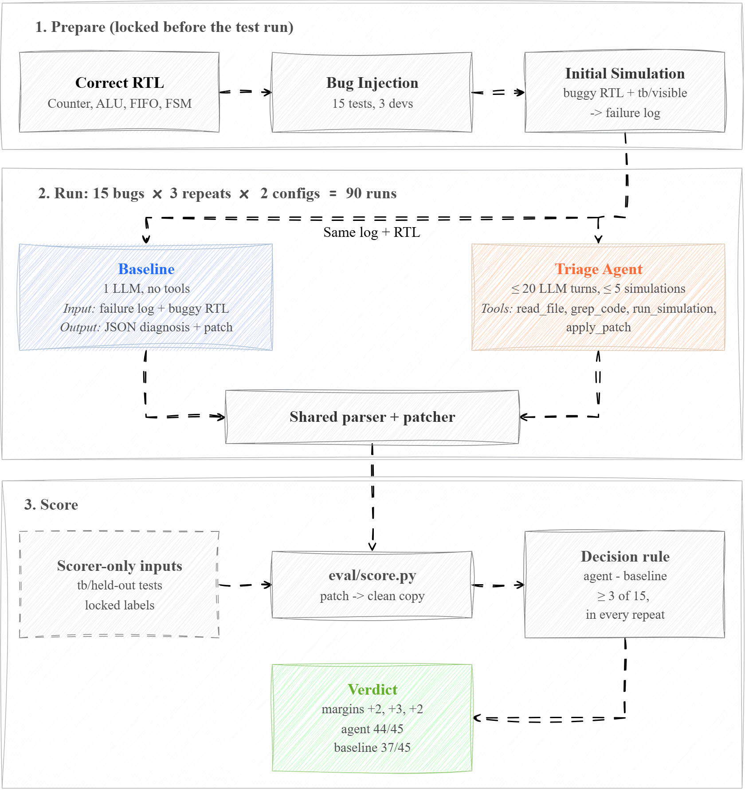
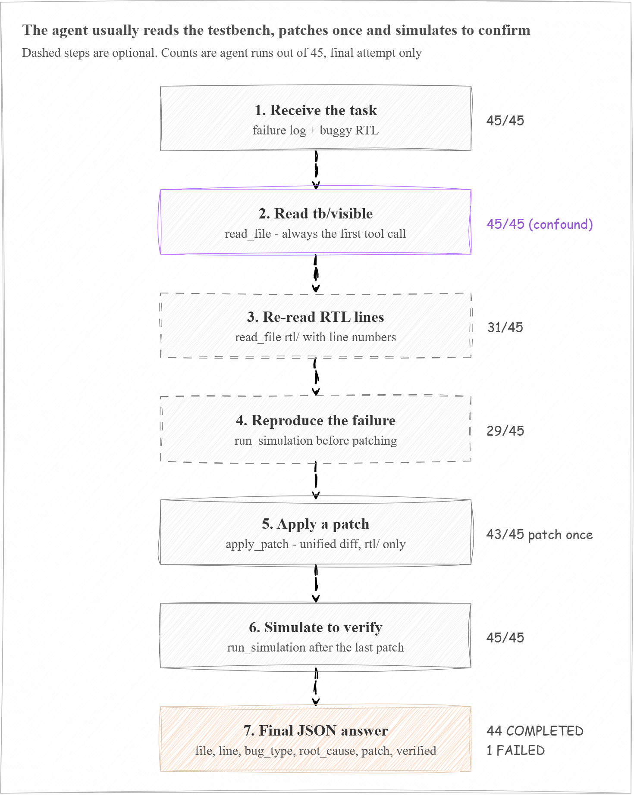

# LLM Agent for RTL Failure Triage

A tool-calling LLM agent receives a buggy Verilog design and a failing simulation log. It reads the code, localizes the root cause, applies a patch and re-runs the simulation to check the fix. The project measures whether this loop does better than asking the same model once, under rules fixed before any result existed.

[](https://en.wikipedia.org/wiki/Verilog)
[](https://www.python.org/)
[](https://www.cocotb.org/)
[](https://steveicarus.github.io/iverilog/)
[](https://www.docker.com/)
[](https://aws.amazon.com/bedrock/)

**Quick links:** [Architecture](#project-overview) · [Tech stack](#tech-stack) · [Results](#results) · [Reproduce](#reproduce) · [Limitations](#limitations)

## Project overview

The diagram below shows the experiment from bug injection through baseline and triage runs to independent scoring. Held-out tests and locked labels are only used by the scorer.



### Triage agent flow

This flow zooms in on the triage agent run. It receives the failing simulation log and buggy RTL, then reads the visible testbench. Depending on the failure, it may inspect additional RTL lines or simulate the bug before patching; those optional steps are shown with dashed outlines. The agent applies a patch to the RTL and runs a final simulation before returning a structured JSON diagnosis. Counts in the diagram are from the final attempt of each of the 45 agent runs. Reading the visible testbench happened in every run, so the measured comparison also reflects the agent's access to test information that the baseline did not receive.



## Tech stack

| Layer | Technology | Use |
| --- | --- | --- |
| RTL designs | Verilog-2005 | Counter, ALU, FIFO, and FSM designs with injected single-fault bugs |
| Simulation | Icarus Verilog 12, cocotb 2.1.0 | Run visible and held-out hardware tests |
| Agent and experiment tooling | Python 3.12 | Agent loop, tool sandbox, experiment runner, parser, patcher, and scorer |
| Model API | AWS Bedrock Converse, Claude Haiku 4.5 | Generate diagnoses and candidate patches |
| Environment | Docker, Ubuntu 24.04 | Pin the simulator and Python execution environment |
| Offline checks | pytest 8.3.4 | Validate project logic without making model API calls |

**Result.** On 15 held-out bugs × 3 repeats, the agent fixed more bugs than the single-shot baseline in every repeat: held-out pass 14 / 15 / 15 against 12 / 12 / 13. The pre-registered criterion was a margin of at least 3 bugs in *all three* repeats. The margins were +2, +3 and +2, so the registered verdict is **`INSUFFICIENT_EVIDENCE`**. The project does not claim that the agent is better.

## Results

Test split, Claude Haiku 4.5 on AWS Bedrock, 15 bugs × 3 repeats = 45 runs per configuration, run on 2026-11-07. Source: [`results/test_main_1/summary.md`](results/test_main_1/summary.md).

| Metric | Baseline (single shot) | Triage agent |
| --- | --- | --- |
| Root cause localized (right file, ±3 lines) | 39/45 (86.7%) | 44/45 (97.8%) |
| Bug type classified correctly | 35/45 (77.8%) | 41/45 (91.1%) |
| Patch passes visible tests | 37/45 (82.2%) | 44/45 (97.8%) |
| **Patch passes held-out tests (primary)** | **37/45 (82.2%)** | **44/45 (97.8%)** |
| First patch passes held-out | 37/45 (82.2%) | 44/45 (97.8%) |
| LLM calls per bug (mean) | 1.0 | 5.6 |
| Cost per bug (USD) | $0.0072 | $0.0859 |

**Decision rule** (registered in [`docs/preregistration.md`](docs/preregistration.md) before the test run):

| Repeat | Agent held-out | Baseline held-out | Margin | Criterion (≥ 3) |
| --- | --- | --- | --- | --- |
| 1 | 14 | 12 | +2 | not met |
| 2 | 15 | 12 | +3 | met |
| 3 | 15 | 13 | +2 | not met |

The registered conclusion is that the experiment does not provide sufficient evidence to claim that the triage agent outperforms the baseline.

**What the numbers do and do not show.** See [`docs/failure_analysis.md`](docs/failure_analysis.md) for the full analysis.

- Almost the entire gap is on the FSM design: baseline 8/15 against agent 14/15. On the ALU and FIFO, both configurations solved every bug.
- The agent's first patch was already its final answer in 44/45 runs. On this bug set, simulating and re-patching never rescued a bug.
- The agent read the visible testbench in 45/45 runs, and the baseline never sees it. The measured gap therefore mixes *more information* with *the ability to simulate*. Separating the two needs an ablation that was not run.
- The agent's only held-out failure was a format failure: two JSON answers in one message, scored 0 under the registered parser rule. Re-scoring it would not change the verdict, because repeat 3 is still +2.
- The agent costs about 12× more per bug.

## How it works

```text
correct RTL ──inject one bug──► buggy RTL ──run tb/visible──► failure log
                                                  │
                     ┌────────────────────────────┴───────────────────────────┐
                     ▼                                                        ▼
            Baseline: 1 LLM call                               Triage agent: up to 20 LLM turns
            input = log + RTL                                  input = log + RTL, plus 4 tools:
            output = JSON with diagnosis + patch               read_file, grep_code,
                                                               run_simulation (≤ 5), apply_patch
                     │                                                        │
                     └──────────────► same parser, same patcher ◄─────────────┘
                                                  │
                         eval/score.py: apply the patch to a clean copy of the buggy RTL,
                         run tb/visible AND tb/heldout (never shown to either config),
                         compare file/line/type with the locked labels
```

| Part | Path | Role |
| --- | --- | --- |
| Designs | `rtl/` | `counter`, `alu`, `fifo`, `fsm_controller` in Verilog-2005 |
| Specs | `docs/specs/` | Behaviour each design and test is checked against |
| Testbenches | `tb/visible/`, `tb/heldout/` | cocotb tests; the agent may run `visible`, `heldout` is only used for scoring |
| Bugs | `bugs/catalog.yaml`, `bugs/inject.py`, `bugs/variants/` | 18 single-fault bugs, 7 bug types (3 dev, 15 test) |
| Labels | `labels/labels.json`, `labels/labels.lock` | Ground truth (file, line range, type) and SHA-256 lock |
| Simulator wrapper | `scripts/run_sim.py` | Icarus Verilog + cocotb, timeout, machine-readable result from `results.xml` |
| Agent | `agent/` | Bedrock Converse client, agent loop, sandboxed tools, cost ledger with $15 hard stop |
| Baseline, parser, patcher | `eval/run_baseline.py`, `eval/parser.py`, `eval/patcher.py` | Shared by both configurations |
| Experiment runner | `eval/run_experiment.py` | 15 × 2 × 3 runs, resumable, refuses the test split without explicit confirmation and integrity checks |
| Scorer | `eval/score.py` | Independent re-simulation and metrics; locked before the test run |
| Reports | `analysis/make_report.py` | `scores.csv`, `summary.md`, `breakdown.md`, `review_queue.csv` from `scores.json` |

The agent's workspace contains only the buggy RTL file and `tb/visible`. It cannot read labels, the held-out tests or the catalog, and it cannot modify the testbench.

## Experimental design

- **Bugs.** 18 hand-designed single-fault bugs across 7 types: `fifo_flag`, `fsm_invalid_transition`, `reset_polarity`, `blocking_nonblocking`, `bit_width_mismatch`, `missing_branch`, `off_by_one`. When a bug fits two types, a fixed priority order decides the label. Every bug fails both test suites, and applying the reference fix restores the original RTL exactly (`bugs/validate.py`). 3 bugs are used for development, and 15 are held back for the test run.
- **Configurations.** Same model (`global.anthropic.claude-haiku-4-5-20251001-v1:0`, `ap-southeast-1`), same `max_tokens = 8192`, no sampling parameters sent, same initial log and RTL, same parser and patcher. The only difference is the tools and the loop.
- **Metrics.** Localization (right file, within ±3 lines of the labelled range), classification, visible pass, held-out pass (primary), first-patch pass, turns, simulations and cost. A run that ends `FAILED` (unparseable answer) scores 0 on every metric. A run that ends `EXCEEDED_LIMIT` scores 0 on final metrics, and only its first patch is still scored. Infrastructure errors are retried up to twice, then excluded from denominators and counted as a failure for the decision rule. There were none in the test run. The model's own `verified` field is never used.
- **Decision rule.** The agent is called better only if its held-out pass count exceeds the baseline's by ≥ 3 of 15 in each of the 3 repeats. Otherwise the result is "insufficient evidence". This is a practical threshold, not a statistical test, and the repeats are not independent samples.
- **Integrity.** The project is committed once at the end, so git history cannot prove the order of events. Instead:
  - `labels/labels.lock` locks the labels, bugs and pre-registration.
  - `docs/gate4_hashes.sha256` locks every file in `agent/` and `eval/` (prompts and scorer included) before the test run.
  - Each run's `manifest.json` records 49 hashes, the model, parameters and tool versions.
  - The runner refuses the test split if any hash differs.

  Hashes prove that files did not change *after* they were recorded, not when they were written.
- **Changes made before the test run**, all logged with reasons in `docs/preregistration.md`:
  - Parser rule: accept exactly one fenced JSON block.
  - Retry of the identical request on Bedrock's `malformed_model_output`.
  - One format-only addition to the agent prompt.
  - Temporary switch to Amazon Nova 2 Lite and back to Haiku 4.5.

  Rejected alternatives are listed in `docs/rejected_proposals.md`.

## Reproduce

Requirements: Docker. The image pins Ubuntu 24.04, Icarus Verilog `12.0-2build2`, Python 3.12 and cocotb 2.1.0. All commands run from the repository root and work in PowerShell or bash.

```bash
docker build -t rtl-triage:phase1 .
```

**Re-score the committed raw results (no API, no cost):**

```bash
docker run --init --rm -v "${PWD}:/workspace" -w /workspace -e PYTHONPATH=. -e PYTHONDONTWRITEBYTECODE=1 rtl-triage:phase1 \
  python3 eval/score.py --results-dir results/test_main_1 --out-json results/test_main_1/scores.json
docker run --init --rm -v "${PWD}:/workspace" -w /workspace -e PYTHONPATH=. -e PYTHONDONTWRITEBYTECODE=1 rtl-triage:phase1 \
  python3 analysis/make_report.py --run-dir results/test_main_1 --failure-analysis-path results/test_main_1/failure_analysis.md
```

`score.py` re-applies every patch and re-runs both test suites, which takes a few minutes. Two consecutive runs produce byte-identical `scores.json` (compare with `results/test_main_1/scores_rerun.json`). Pass `--failure-analysis-path` as shown, otherwise the report script overwrites `docs/failure_analysis.md` with an empty template.

**Integrity and unit tests (no API, no cost):**

```bash
docker run --init --rm -v "${PWD}:/workspace" -w /workspace -e PYTHONPATH=. -e PYTHONDONTWRITEBYTECODE=1 rtl-triage:phase1 python3 scripts/check_lock.py
docker run --init --rm -v "${PWD}:/workspace" -w /workspace -e PYTHONPATH=. -e PYTHONDONTWRITEBYTECODE=1 rtl-triage:phase1 python3 bugs/validate.py
docker run --init --rm -v "${PWD}:/workspace" -w /workspace -e PYTHONPATH=. -e PYTHONDONTWRITEBYTECODE=1 rtl-triage:phase1 pytest -q -p no:cacheprovider tests/
```

The unit tests use a scripted fake LLM and cover the agent loop, sandbox, parser, patcher, runner, scorer and report script.

**Run the experiment again (calls AWS Bedrock and costs money):** copy `.env.example` to `.env`, fill in your AWS credentials, and make sure your account can invoke Claude Haiku 4.5 in `ap-southeast-1`. The original test run cost $4.19. The cost ledger stops all calls once cumulative cost reaches $15. The committed ledger `results/budget_ledger.json` already holds $4.91, so pass `--ledger-path results/my_ledger.json` to start from zero. Use a new `--run-id` so the original results are not touched.

```bash
docker run --init --rm -v "${PWD}:/workspace" -w /workspace -e PYTHONPATH=. -e PYTHONDONTWRITEBYTECODE=1 --env-file .env rtl-triage:phase1 \
  python3 eval/run_experiment.py --split dev --repeats 1 --run-id my_dryrun
docker run --init --rm -v "${PWD}:/workspace" -w /workspace -e PYTHONPATH=. -e PYTHONDONTWRITEBYTECODE=1 --env-file .env rtl-triage:phase1 \
  python3 eval/run_experiment.py --split test --confirm-test-run --repeats 3 --run-id my_test_run
```

An interrupted run continues when the same command is run again: completed runs are skipped and nothing is overwritten. LLM outputs are not deterministic, so a rerun will not reproduce the exact numbers above.

## Cost

| Item | LLM calls | Cost (USD) |
| --- | --- | --- |
| Test run (Haiku 4.5) | 328 | $4.19 |
| Dev runs and dry run (Haiku 4.5) | 48 | $0.58 |
| Dev runs (Nova 2 Lite, abandoned) | 70 | $0.14 |
| **Total** | **446** | **$4.91** |

Costs are computed from the token counts that Bedrock returns, multiplied by list prices ($1 / $5 per million input / output tokens for Haiku 4.5). They have not yet been reconciled against the AWS bill.

## Limitations

- **Small sample.** 15 test bugs and 1–4 bugs per type. One run moves a rate by about 7 points, so nothing can be concluded per bug type.
- **Synthetic, single-fault bugs in four small designs.** The results say nothing about large designs, multiple interacting faults or real regression failures.
- **Tests can be weak.** Passing visible and held-out tests is evidence, not proof, of a correct fix. The held-out suites were strengthened with mutation testing, but gaps may remain.
- **Information asymmetry.** The agent can read the visible testbench and the baseline cannot. The comparison is "agent with tools" against "single shot", not "loop" against "no loop".
- **Possible prior exposure.** Traffic-light FSMs, FIFOs and counters are common, and the model may have seen similar designs.
- **Manual review not done.** `results/test_main_1/review_queue.csv` lists 26 runs whose passing patch differs textually from the reference fix. A pre-screen found all of them equivalent (see `docs/failure_analysis.md`, section 6), but the planned manual review (H6.1) has not been performed. The automated numbers above are the registered result either way.
- **Prompt difference from early dev runs.** The format section of the agent prompt was added after the first Haiku dev runs. The test run and the final dry run used the same frozen prompt.

## Repository layout

```text
agent/            agent loop, tools, Bedrock client, budget ledger, prompts
analysis/         report generation from scores.json
bugs/             bug catalog, injector, validator, buggy variants
docs/             pre-registration, specs, phase reports, failure analysis, hashes
eval/             baseline, parser, patcher, experiment runner, scorer
labels/           ground-truth labels and lock file
results/          raw traces, manifests, scores and reports of every run (test_main_1 is the main run)
rtl/              correct Verilog designs
scripts/          simulator wrapper, lock checker
smoke/            Phase 1 sanity check of the simulator setup
tb/               visible and held-out cocotb testbenches
tests/            offline unit tests
```

The pre-registration, specifications, and phase reports contain project documentation. See `RTL Failure Triage Agent Implementation Plan.md` for the implementation plan.

## License

MIT, see [`LICENSE`](LICENSE). No third-party source code is vendored. Icarus Verilog, cocotb and the Python packages in `requirements.txt` are used as dependencies under their own licenses.
